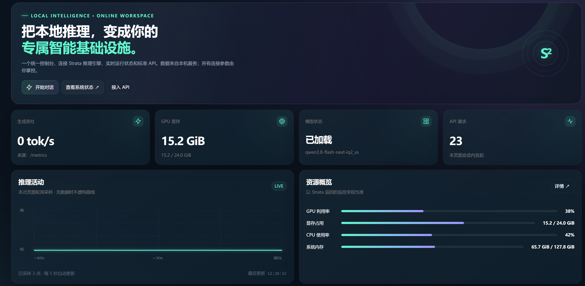
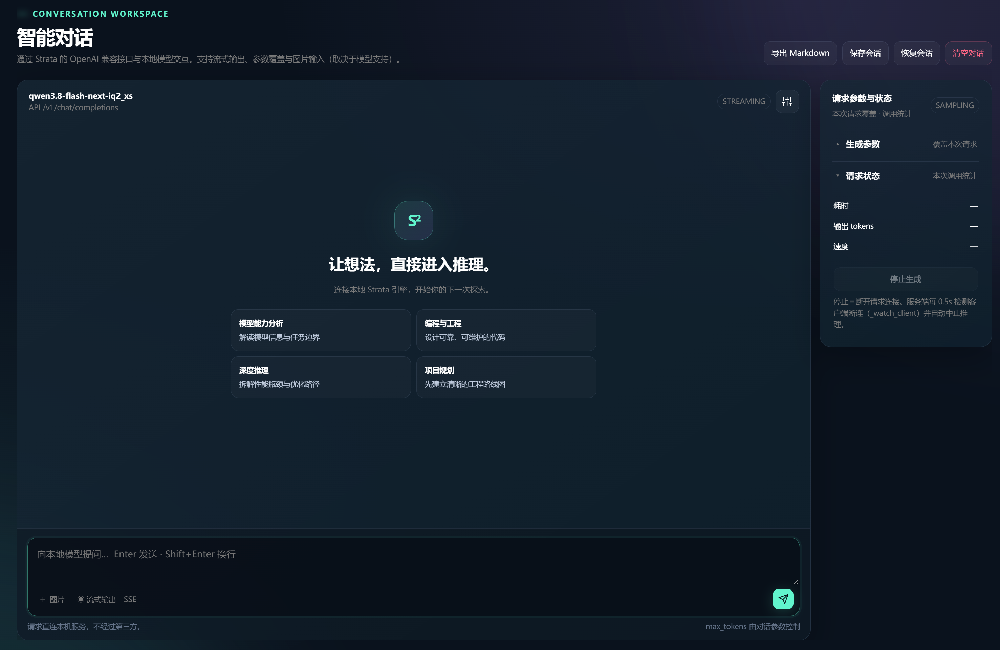
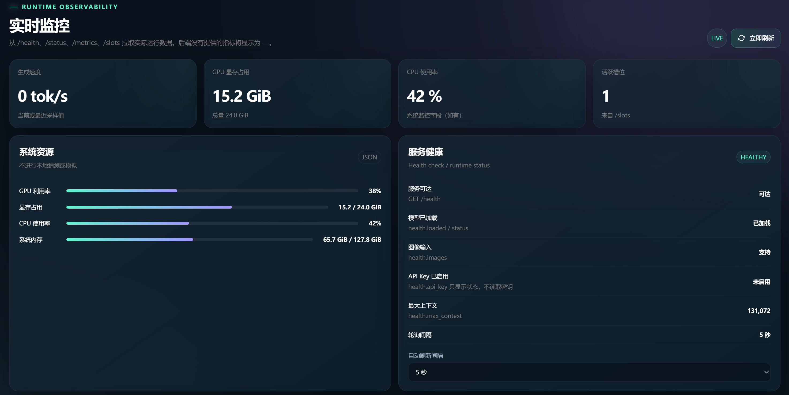
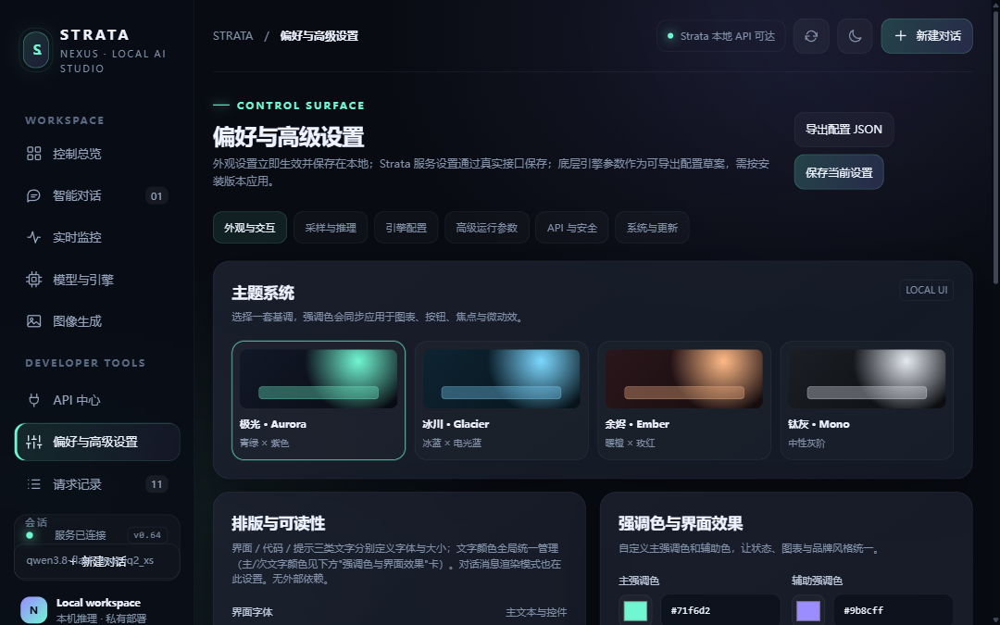
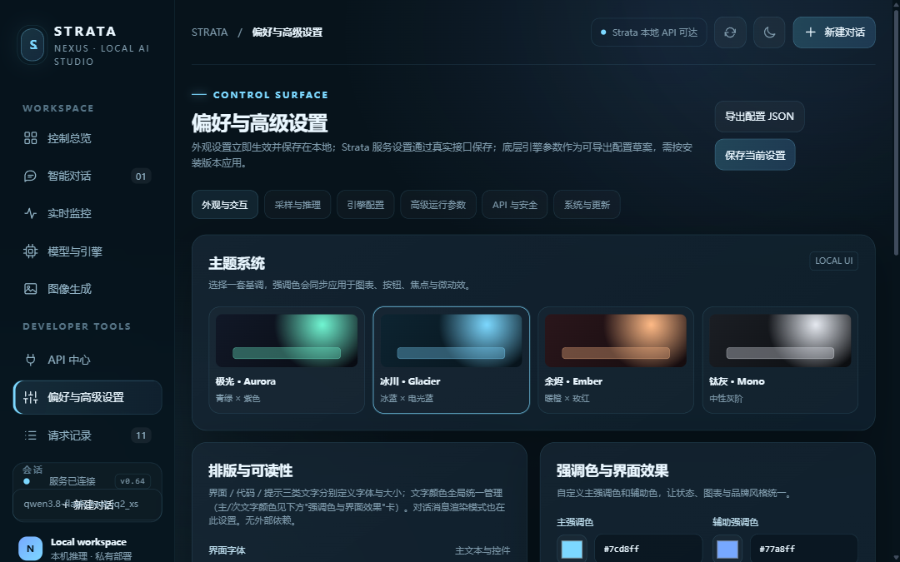
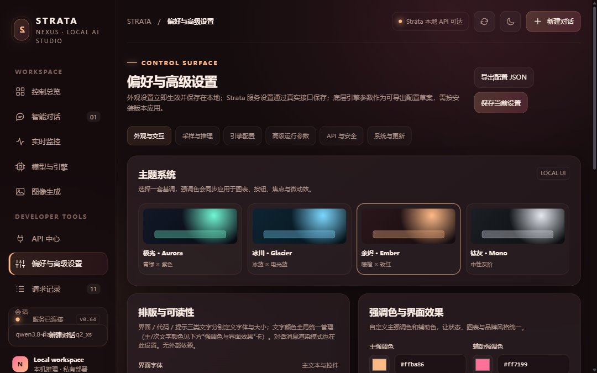
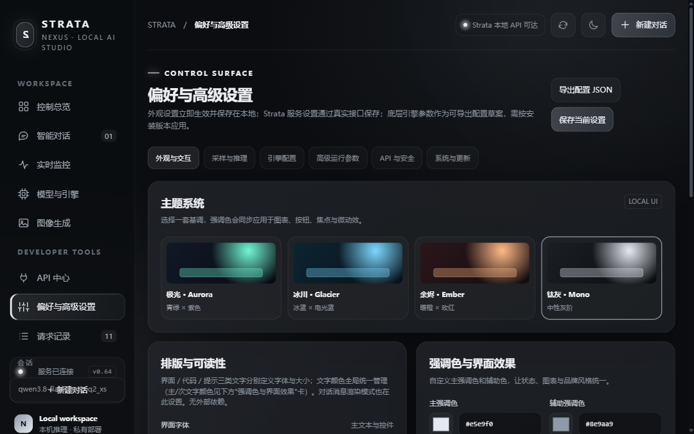

# Strata NEXUS — Local LLM Workstation (Frontend Custom Edition)

[简体中文](README.md) · **English**

  

**Current release v0.68** (2026-10-27) · see the [中文更新日志](CHANGELOG.md) for release notes

A **deeply customized frontend** for the [Niko1221/Strata](https://github.com/Niko1221/Strata) engine. The engine stays stock — the entire interface is rebuilt: local inference that looks, feels and tunes like a proper workstation.

## Screenshots

**Overview** — generation speed / VRAM / model status / API traffic on one screen



**Chat** — streaming, Markdown rendering, folded reasoning, parameter panel; the whole page is viewport-locked with no layout jumps



**Monitoring** — live GPU/VRAM/CPU/RAM levels plus service health checks (health/status/metrics/slots)



**Preferences** — themes / fonts / colors / motion, all adjustable in-app, applied instantly and persisted locally


**Four themes (fully tokenised in v0.64: 22 colour variables per theme — accent, secondary, text, panels and code blocks all switch with the theme)**

| Aurora | Glacier | Ember | Mono |
|---|---|---|---|
|  |  |  |  |

## What changed vs. the stock frontend

### Interface architecture
- **All-new NEXUS visual system**: dark glassmorphism + ambient glow, replacing the stock interface
- **4 themes, fully tokenised** (Aurora / Glacier / Ember / Mono): 22 colour variables per theme — accent, secondary, text, panels and code blocks all follow the theme, and the accent picker is synced to each theme's preset palette; plus compact/comfortable density and independent toggles for ambient glow, flicker motion and reduced motion
- **Custom accent colors**: theme color, secondary color, primary/muted text colors managed globally

### Typography & readability
- **Three-zone font sizing**: interface / code / hint sizes as separate sliders (globally calc-derived, every step visible), independent of each other
- **Per-chat text control**: separate chat font size + color; Markdown / plain rendering selectable, **Markdown by default** (headings, tables, code blocks, quotes)
- **3 syntax highlighting schemes** (follow-theme / Classic / GitHub), hand-written tokenizer, zero dependencies
- Hint-size auto-adaptation: when the browser clamps minimum font size, the slider floor is raised automatically so every step stays visible

### Models & engines (v0.68)
- **DeepSeek image input**: the engine's own vision tower (the server resizes to the engine grid and hands `GENI` a DSI1 file of raw RGB), not the Qwen-side `strata-vision` encoder; `/health` and `/v1/models` report it consistently and the page shows 支持 (supported)
- **DeepSeek context up to 300K**: native 64K, `--max-context` accepts 307200, ceiling 1M; the page and `/v1/models` show the live value
- **Default model per line**: besides "switch to this", each installed model row has "set as default", which only writes `engine\.last-model.json` for the next `START.bat` and never touches the running process
- **Installed models list**: the Models page shows both the online model (`/v1/models`) and every local config (`engine\strata-*.json`, with context, port and running state); an idle one gets a **Switch to this** button that restarts into it and reloads the page
- **Startup memory**: `START.bat` launches the model used last (`engine\.last-model.json`) instead of always Qwen
- **VRAM control follows the engine**: Qwen resizes live through `/v1/vram`; the DeepSeek engine has no such command, so the page writes the reserve into the start config and restarts, and says so
- **Capability gating**: controls the current engine cannot serve (DeepSeek load/unload, updates in a dev install) are greyed out with the reason instead of failing on click
- **Parameters follow the model**: the runtime page shows MTP / speculative (`mtp`, `spec_tokens`, `spec_min_p`) on Qwen and DSpark (`dspark`, `dspark_block`, `dspark_conf`) on DeepSeek; only the current model's keys are written
- **Image page notes**: states that image generation belongs to the Qwen side (Qwen-Image-2.1-Turbo via sd-cli), is OFF until an `images` section exists, and lists the local `qwen_image_2.1_turbo_bf16.safetensors` with the enabling steps

### Chat experience
- **Smart scrolling**: browse freely while generating, auto-resume on scroll-back + jump-to-bottom button
- **Live streaming stats**: tokens/s and elapsed time update per token, replaced by exact values on finish
- **Reasoning folded by default** (summary with token count, expandable)
- **Message actions**: copy / edit (removes following messages) / regenerate / delete
- **Long-prompt progress bar**: shows ingestion progress for >8K-token prompts, stepping per chunk with a running timer

### Data & sessions
- **Session persistence**: one-click save/restore (engine state paired with frontend messages), survives restarts
- **Markdown export** of conversations
- **API request monitor**: last 100 requests viewable in-app

### Polish
- Message alignment (AI flush-left full-width, user bubbles right), input focus glow, unified thin scrollbars
- Tabular numerals for live metrics (no jitter), inner-scrolling code blocks, responsive narrow-window layout
- Server config hot-saved via /config; frontend preferences persisted in localStorage

## Deployment (Windows + NVIDIA GPU)

1. **Clone**
   ```
   git clone https://github.com/SuperWJ062/Strata-NEXUS.git
   cd Strata-NEXUS
   ```
2. **First run**: double-click `engine\START-HERE.bat` and follow the prompts (the model files download automatically — see below; **you may also download them yourself, the two ways never conflict**)
3. **Daily start**: double-click `START.bat` — loads the model and opens `http://127.0.0.1:8080/`

## Model downloads (sources and process)

Current setup uses **Qwen3.8-Flash-Next IQ2_XS**.

**Model repository (Hugging Face)**:
> **https://huggingface.co/ISTA-DASLab/Qwen3.8-Flash-Next-GSQ-RCO-GGUF**
> (China mirror: https://www.modelscope.cn/models/ISTA-DASLab/Qwen3.8-Flash-Next-GSQ-RCO-GGUF )

Three things to download (main model + MTP draft layer + vision encoder). **Two ways, mix and match, never conflict**:
- **Option A (automatic)**: downloaded by `START-HERE.bat` during first run
- **Option B (manual)**: download from the repository above with any downloader, place the files as noted below

**Why they never conflict**: for every file the script first checks whether the target already exists; if it does, it verifies SHA-256 and **skips the download** (verified output: `[ok] ... already downloaded`). Files are only downloaded when missing or corrupt.

| Item | Size | Files | Destination |
|---|---|---|---|
| Main model | ~68 GB (2 shards) | `Qwen3.8-Flash-Next-GSQ-RCO-IQ2_XS-0000{1,2}-of-00002.gguf` | `Strata-data/models/IQ2_XS/` |
| MTP draft layer | ~5 GB | extracted from the original Qwen BF16 checkpoint by `tools/mtp_fetch.py` (tensor-hash verified) | `Strata-data/mtp/rt` (automatic) |
| Vision encoder | ~1 GB | `mmproj-Qwen3.8-Flash-Next-BF16.gguf` | `Strata-data/models/` |

**The automatic process**: first run asks 4 questions (family / quant / context / images), then downloads in order with resume support, verifies every shard by SHA-256, prepares the engine pack (`Strata-data/packs/iq2_xs`, including the tokenizer) and the MTP layer, then writes the start scripts.

**Mainland China**: if huggingface.co is unreachable, use `--source modelscope` (or `STRATA_SOURCE=modelscope`) to switch to the ModelScope mirror — same repositories, same file paths.

### ④ DeepSeek-V4.1-Flash-1017 (optional large model, ~232 GiB at 2.00bpw)

A 544B sparse MoE (40 layers × 384 experts, 6 active per token): more context and image input than the Qwen tier, at a lower speed.

- Weights: `ISTA-DASLab/DeepSeek-V4.1-Flash-1017-GSQ-RCO-GGUF`, IQ2_XXS in four shards (128.8 GiB) + Engram IQ4_NL (103 GiB, shared by 2.00/2.25/1.75)
- Engine: `strata-dsv41` 0.1.51, installed in its own folder beside the Qwen engine
- **Image input (v0.68+)**: also needs `mmproj-DeepSeek-V4.1-Flash-1017-BF16.gguf` (~1 GB, same repository). The shards must be the **2026-10-26 or later** build — earlier ones carry a chat template without `image_url`, so the model cannot read pictures. Once set up, `/v1/models` reports `input_modalities: ["text", "image"]`
- **Context**: native 64K, up to **307200 (300K)**, ceiling 1M. It costs what you set: 300K is about 5.5 GB of VRAM plus 2.4 GB of shared memory; at 8K both are effectively gone
- **Measured** (RTX 4090D 24 GB + i5-13600KF + 128 GB RAM, 2.00bpw, 300K context): **about 11 tok/s**. Six of ten experts per token are computed on the CPU and only 6% of the expert set fits in VRAM — that is the limit
    - context at 8K → 16–19 tok/s
    - a 32 GB card → around 25 tok/s
    - four R9700 → 48 tok/s (upstream figure)
- **VRAM reserve**: every extra GB kept by `--reserve-mib` costs about 110 experts in VRAM; 8180 on a 24 GB card pins you at 11 tok/s, while 700 (the default) reaches 20+ but squeezes the desktop
- Insufficient RAM pushes experts into the page file and drops the speed below 1 tok/s

**Download and deploy (one command)**

Prerequisites: **257 GB of free disk** (138 GB model + 111 GB Engram table + 8 GB drafter), **40 GB of RAM or more**; NVMe strongly recommended on a 24 GB card.

```bat
cd engine
.venv\Scripts\python.exe setup.py --family deepseek41 --model IST-DAS-2.00bpw --vision yes
```

What it does, in order:

1. Downloads the `strata-dsv41` engine (0.1.51, about 398 MB) into `engine\engine-dsv41\`, kept apart from the Qwen engine
2. Pulls from Hugging Face: four model shards (128.8 GiB in total) + the Engram table (103 GiB) + the DSpark drafter (8 GB) + the vision tower (about 1 GB), all **resumable**
3. Checks every file against its SHA-256 and stops naming the one that does not match
4. Packs the shards into the engine's own layout (a `maya-ds4` folder: `ds4.txt` / `tensors.txt` / `tokenizer` / `engram.bin`), about 20 seconds
5. Runs a 16-token smoke test to prove the model really answers (on failure it prints where the log is)
6. Writes `engine\strata-deepseek-v4.1-flash-ist-das-2.00bpw.json` and points `.last-model.json` at it

**Behind the Great Firewall**: append `--source modelscope` to use the ModelScope mirror; repositories and file paths are identical.

**Prefer 2.25bpw** (better quality, slightly slower, 17 GB more disk): replace `--model IST-DAS-2.00bpw` with `--model IST-DAS-2.25bpw`.

**Downloading by hand (a download manager is faster)**

| File | Where it goes |
|---|---|
| `DeepSeek-V4.1-Flash-1017-GSQ-RCO-IQ2_XXS-0000{1..4}-of-00004.gguf` | any folder under `Strata-data\models\` |
| `DeepSeek-V4.1-Flash-Engram-IQ4_NL.gguf` | the same folder |
| `dspark-DeepSeek-V4.1-Flash-1017-Q8_0.gguf` | the same folder |
| `mmproj-DeepSeek-V4.1-Flash-1017-BF16.gguf` | the same folder, beside the model |

Then **run the command above again**: files already present are skipped, and only verification and packing run.

**First start** reads about 130 GB of weights: roughly 20–40 seconds on a 24 GB card with NVMe. Daily starts after that are instant through `START.bat`.

**Going back to Qwen**: click "switch to this" on the models page, or point `engine\.last-model.json` at `strata-iq2_xs.json`. The two engines live in separate folders and never hold VRAM at the same time.


## Updating to a new release

Two steps in the deploy folder:

```
git pull
engine\UPDATE.bat
```

- `git pull` updates the frontend (`engine/serve/web/index.html`), scripts and docs — the interface upgrades with the repository
- `engine\UPDATE.bat` incrementally updates Python dependencies and the prebuilt engine; **models, MTP and session data are never touched or re-downloaded**
- Your machine-local config (`engine/strata-iq2_xs.json`, `run-iq2_xs.bat`) is generated by setup on first deployment and is **not managed by git — updates can never conflict with it**
- Want the author's parameter set? See `engine/strata-iq2_xs.json.release` (a reference template, never read at runtime)

## Relationship to upstream

- Custom code lives in `engine/serve/web/index.html` (frontend) and `strata-iq2_xs.json.release` (reference config)
- Engine updates follow the official route: run `SYNC-UPSTREAM.bat` to pull upstream releases — the frontend customization is isolated and never conflicts

## Repository layout

```
├─ START.bat            daily start (load model + open browser)
├─ SYNC-UPSTREAM.bat    pull engine updates from upstream
├─ shots/               UI screenshots
├─ engine/              Strata engine (official sources + custom frontend)
│  └─ START-HERE.bat    first-run entry point
└─ Strata-data/         models and sessions (downloaded/generated on first run, not in git)
```

## Author & License

**Author**: [猫叔哥-](https://space.bilibili.com/108196159) (GitHub: [SuperWJ062](https://github.com/SuperWJ062)) — all NEXUS frontend, server configuration and deployment documentation customization.

**License**

| Component | License | Notes |
|---|---|---|
| This repository (NEXUS custom layer) | [MIT](LICENSE) | frontend customization, packaging, docs |
| Strata engine (upstream [Niko1221/Strata](https://github.com/Niko1221/Strata)) | MIT | Copyright (c) 2026 Niko1221 and the Strata contributors |
| llama.cpp / ggml | MIT | inference components |

**Model licenses** (model files are not part of this repository; comply with their own terms):
- Base model [Qwen3.8-Flash-Next](https://huggingface.co/Qwen/Qwen3.8-Flash-Next) — Qwen team
- IQ2_XS quantization [ISTA-DASLab/Qwen3.8-Flash-Next-GSQ-RCO-GGUF](https://huggingface.co/ISTA-DASLab/Qwen3.8-Flash-Next-GSQ-RCO-GGUF) — see the repository page for its license
- MTP draft layer extracted from the official Qwen checkpoint

## Acknowledgements

- [Niko1221/Strata](https://github.com/Niko1221/Strata) — the excellent local LLM engine this project builds on
- [Qwen team](https://huggingface.co/Qwen) — the original Qwen3.8-Flash-Next model
- [ISTA-DASLab](https://huggingface.co/ISTA-DASLab) — the GSQ-RCO quantization
- [llama.cpp / ggml](https://github.com/ggml-org/llama.cpp) — underlying inference
